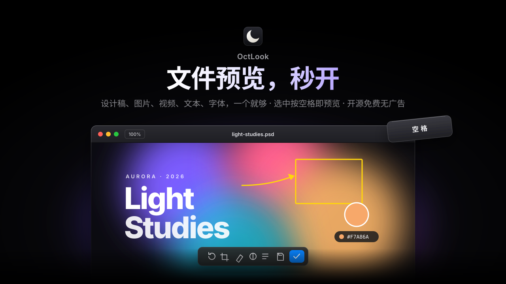
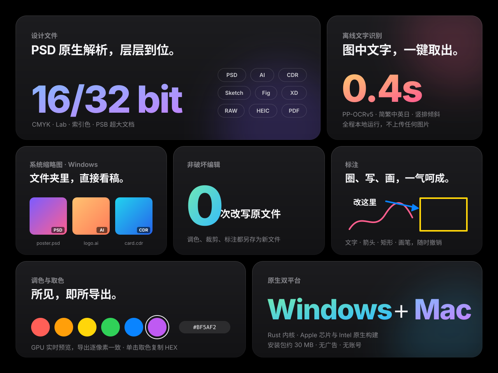

<p align="center"></p>

<p align="center">
  <a href="https://github.com/Octy-10/OctLook/releases/latest"></a>
  <a href="https://github.com/Octy-10/OctLook/actions/workflows/build.yml"></a>
  
  <a href="LICENSE"></a>
</p>

<p align="center"><a href="https://github.com/Octy-10/OctLook/releases/latest"><b>下载最新版</b></a> · 启动时自动检查新版本，也可在设置菜单中手动检查</p>

# OctLook

专为设计师打造的极简无广告文件预览工具：PSD、AI、CDR、EPS、Sketch 等设计文件秒开，图片、视频、音频、文本代码与字体也一并预览；资源管理器直接显示设计文件缩略图，选中文件按空格即可快速预览（Windows）。Tauri 2（Rust）+ React 19 + TypeScript，支持 Windows 与 macOS。

作者：[十月](https://github.com/Octy-10)

## 核心亮点

<p align="center"></p>

- **设计文件秒开**：PSD / PSB 由 Rust 自研解析（含 16/32 bit、CMYK、Lab），AI / PDF 矢量渲染放大不糊，CDR、Sketch、XD、Figma、Affinity 等读取内嵌预览，相机 RAW 与 HEIC 也能直接看。
- **空格预览**（Windows）：在资源管理器或桌面选中文件按空格，弹出按原始比例显示的预览窗，方向键切换文件时预览跟随，再按空格或 Esc 关闭；预览窗不抢焦点。
- **多种格式一站预览**：视频、音频（显示专辑封面）、文本与代码（自动识别 GBK 等编码，语法高亮，Markdown 渲染）、字体（多字号样张）都能直接预览；设计文件、PDF、代码等还能一键用电脑上更专业的软件（如 Photoshop、VS Code）打开。
- **系统级缩略图**（Windows）：安装后资源管理器直接显示 PSD、AI、EPS、SVG、CDR 等文件的缩略图，并带与官方软件配色一致的格式角标，不用再逐个打开确认。
- **离线文字识别**：内置 PaddleOCR PP-OCRv5 轻量模型，一键提取简繁中文、英文、日文，竖排与倾斜文字也能识别；全程本地运行，不上传任何图片。
- **随手标注与裁剪**：文字、箭头、矩形、画笔四种标注，支持撤销 / 重做；裁剪可锁定比例或直接输入像素尺寸。
- **调色与取色**：曝光、对比度、色温等实时预览，导出与预览逐像素一致；取色器单击复制 HEX，文件信息自动列出主色与印刷尺寸。
- **非破坏、轻量、干净**：原文件从不被改写，结果另存为新文件；扁平化界面、深浅色主题、右键快捷菜单；开源免费，无广告、无账号、不联网（检查更新除外）。

## 格式支持

| 格式 | 方式 | 说明 |
| --- | --- | --- |
| JPG PNG GIF WebP AVIF BMP ICO SVG | WebView 原生解码 | 零拷贝、支持动图、自动 EXIF 方向；SVGZ 先解压再按 SVG 显示 |
| PSD / PSB / PSDT | Rust 自研合成图解析 | 1/8/16/32 bit；RGB/CMYK/灰度/索引/Lab；RLE/ZIP；透明通道。需保存时开启「最大兼容」，否则回退内嵌缩略图 |
| AI / AIT（PDF 兼容）/ PDF | pdf.js 矢量渲染 | 放大时按分辨率档位重绘，始终清晰；多页翻页 |
| EPS / PS | Ghostscript 转 PDF 后矢量渲染 | 内置 Ghostscript（AGPL-3.0），无需另装；资源管理器缩略图使用文件内嵌预览 |
| AI（旧版）/ INDD / INDT | 内嵌预览 | XMP 缩略图 |
| CDR / CDT（7 – 2024） | 内嵌预览 | X4+ ZIP 内的缩略图 / RIFF `DISP` 位图 |
| Sketch / XD / Fig / Krita / ORA / Procreate / Affinity | 内嵌预览 | 读取文件内置的扁平化预览图 |
| Blender（.blend） | 内嵌预览 | 保存时生成的缩略图，支持 zstd / gzip 压缩的文件 |
| ICNS（macOS 图标） | 内嵌 PNG | 取图标集中最大的一张 |
| 相机 RAW（CR2 CR3 NEF ARW DNG RAF ORF RW2 …） | 内嵌全尺寸 JPEG | 预览过小时回退系统 RAW 解码器 |
| TIFF TGA DDS HDR EXR QOI PNM | `image` crate | 浮点图做伽马编码；失败回退系统解码器 |
| HEIC / HEIF / JXL / JXR | 系统解码器 | Windows 用 WIC（依赖已安装的编解码扩展）；macOS 用 ImageIO（JXL 需 macOS 14+，不支持 JXR） |

| 视频：MP4 MOV WebM MKV AVI WMV FLV TS MPG 3GP … | WebView 播放 | 浏览器能解码的编码（H.264、VP8/VP9、AV1 + AAC、Opus、MP3）可直接播放；HEVC、ProRes、MPEG-2、WMV 等暂不支持播放，计划通过内置 FFmpeg 转码 |
| 音频：MP3 AAC M4A WAV FLAC OGG Opus WMA APE AIFF … | WebView 播放 | 显示内嵌专辑封面（`lofty` 读取）；不能直接解码的编码同上 |
| 文本与代码：TXT MD JSON YAML CSV XML HTML CSS JS TS PY RS GO … | 只读查看 | 自动识别 UTF-8 / UTF-16 / GBK 等编码，最多读取 2 MB；highlight.js 语法高亮；Markdown 经 marked 渲染并用 DOMPurify 净化 |
| 字体：TTF OTF TTC OTC WOFF WOFF2 | 字体样张 | 显示字族、字型、字形数、是否含中文与多字号样张（可编辑样张文字） |

界面左上角的「内嵌预览」标识表示显示的是设计软件保存的预览图，而非完整渲染；鼠标悬停可看到原因（如 AI 未勾选「创建 PDF 兼容文件」、CDR 矢量为私有格式）。

## 编辑与设计师工具

编辑工具只对图片与设计文件开放。所有编辑都是非破坏性的：原文件从不被改写，结果通过「另存为」保存为新文件。切换到其他图片时，未导出的编辑会被丢弃。

- **调色**（`E`）：曝光、对比度、饱和度、色温、色调、色相，以及黑白 / 反相。预览走 GPU 上的 SVG 颜色矩阵滤镜，导出使用同一矩阵逐像素计算，所见即所得。每项右侧的重置按钮（或双击滑块）单独复位。
- **标注**（`A`）：文字、箭头、矩形、画笔，六种颜色；工具栏的滑块随当前工具或选中元素变化（文字调字号，箭头调大小，矩形与画笔调线宽）。文字直接在画面上输入（单击落点即可打字，双击已有文字重新编辑）；选中元素后拖动本体移动，拖动手柄缩放（矩形四边与四角、箭头两端、文字四角，指针随方向变化），`Del` 删除，`Ctrl Z` / `Ctrl Shift Z` 撤销重做。文字在添加时自动摆正，即使图片已旋转或翻转。标注随导出一并写入新文件。
- **裁剪与变换**（`X`）：工具栏左侧可向左 / 向右旋转、水平 / 垂直翻转（锁定比例时旋转会自动对调比例，如 16:9 ↔ 9:16）；自由或锁定比例（原始、1:1、4:3、3:2、16:9、3:4、9:16），可直接输入像素宽高，三分线辅助；`Enter` / 双击应用，`Esc` 取消。
- **前后对比**：按住 `\` 临时查看调色前的画面；编辑面板中可开启可拖动的分屏对比。
- **重置**（`Ctrl R`）：一键撤销调色、裁剪、标注、旋转和翻转。
- **另存为**（`Ctrl S`）：PNG / JPG / WebP，可设质量与长边像素；PDF、AI 等矢量文件按 300 dpi 栅格化。导出结果为 8 bit sRGB，不保留 EXIF 与 ICC 配置文件。
- **复制图像**（`Ctrl C`，或右键菜单）：把当前编辑结果放入剪贴板，直接粘贴到设计软件或聊天窗口。
- **文字提取**（`O`）：PDF / AI 直接读取内嵌文本；其余图片用 PaddleOCR PP-OCRv5 轻量模型（Apache-2.0）在 ONNX Runtime 上离线识别，覆盖简繁中文、英文、日文与竖排、倾斜文字，已裁剪时只识别裁剪区域。模型随安装包分发（约 21 MB），首次使用时加载，不联网。模型由 `scripts/fetch-ocr-models.mjs` 在构建前下载并校验 SHA-256（国内可设 `HF_ENDPOINT=https://hf-mirror.com`）。
- **文件信息**（`I`）：除格式、尺寸、EXIF 外，还显示 300 dpi 下的印刷尺寸和图片主色（单击色块复制 HEX）。

底部工具条只保留高频工具（裁剪、标注、调色、取色、提取文字、另存为），只在查看图片时出现。上一张 / 下一张按钮位于画面左右两侧。缩放比例显示在标题栏左侧，单击在适应窗口与 100% 之间切换；单击左上角的 OctLook 标志返回主页。标题栏右上角显示「用默认软件打开」按钮（如 PSD 显示 Photoshop 图标）：仅对设计文件、PDF、SVG、文本与代码等有更专业编辑软件的格式显示，且该软件已安装时才出现，其他软件可在右键菜单的「打开方式」中选择。右键图片弹出快捷菜单（复制图像 / 路径、打开方式（子菜单列出推荐软件，Windows）、提取文字、另存为等）。标题栏的齿轮按钮打开设置菜单：画布背景、界面外观（跟随系统 / 深色 / 浅色）、全屏、文件操作、空格预览与开机自启开关（Windows）以及「检查更新」。缩略图栏按内容生成缩略图（视频取帧、文本显示首页、字体显示样张），右下角带格式角标；左上角的按钮可展开或收起缩略图栏（`T`）。

## macOS

- 提供 Apple 芯片（`aarch64`）与 Intel（`x64`）两个 `.dmg`，要求 macOS 11 及以上。
- 安装包暂未经过 Apple 公证。首次打开若提示「无法验证开发者」，请在「系统设置 › 隐私与安全性」中点击「仍要打开」，或在终端执行 `xattr -dr com.apple.quarantine /Applications/OctLook.app`。
- 窗口保留系统红绿灯按钮；快捷键中的 `Ctrl` 对应 `⌘`，`Del` 对应 `⌫`。
- 可在访达「打开方式」中选择 OctLook；不会抢占系统默认应用。
- 访达缩略图与快速查看扩展暂未提供（资源管理器缩略图与空格预览目前为 Windows 独有功能）；标题栏的「用默认软件打开」按钮暂不显示。

## 空格预览（Windows）

在资源管理器文件列表或桌面上选中文件，按空格即可预览，体验类似 macOS 访达的快速查看。

- 预览窗按文件原始尺寸显示，超过屏幕时等比缩小到工作区约 80%，居中于资源管理器所在的显示器；音频、文本、字体使用固定的默认尺寸。
- 预览窗不抢焦点：方向键、鼠标在资源管理器里切换选中项时，预览自动跟随；再按空格、Esc 或点预览窗的关闭按钮才会关闭，切换到其他程序时预览保留。
- 预览窗标题栏：单击左上角的 OctLook 标志在完整窗口中打开；右上角可用推荐软件打开或「钉住」。右键可复制文件路径、在资源管理器中显示，或从「打开方式」中选择其他软件。
- 钉住：当前文件移到一个独立窗口（位置不变），不再跟随资源管理器，一直保留到点关闭或在其中按 Esc；再按空格会打开新的预览，可钉住多个文件并排对比。钉住的窗口出现在任务栏中。
- 只在文件列表获得焦点时响应：重命名、地址栏、搜索框中的空格不受影响；按住 Ctrl / Alt / Shift / Win 时也不触发。文件夹和不支持的格式不处理。
- 依赖 OctLook 在后台常驻：开启空格预览后，关闭主窗口只是隐藏到系统托盘（托盘菜单可打开主窗口或退出）。首次运行默认开启空格预览与开机自启（开机时在后台启动，不弹窗口），两者都可在设置菜单中关闭；关闭空格预览会一并关闭开机自启。安装后需先手动打开一次 OctLook。
- 实现方式为低级键盘钩子（`WH_KEYBOARD_LL`）：只检查空格与 Esc，不记录任何按键；少数安全软件可能对此给出提示。选中文件通过 Shell 自动化接口（`IShellWindows` / `IFolderView2`）读取，支持 Windows 11 多标签页。
- 再次启动 OctLook（如双击文件）时不会开第二个进程，文件交给已运行的实例打开。
- 卸载时会删除开机自启项；自动更新时保留。

## 资源管理器缩略图（Windows）

安装包会注册一个 Windows 缩略图扩展（`octlook_shell.dll`，进程隔离运行），让桌面和文件夹直接显示 PSD、PSB、AI、SVG、CDR、Sketch、XD、Figma、Krita、OpenRaster、Affinity 等文件的缩略图。

- SVG 由 resvg 按图标尺寸直接矢量渲染（小图标也清晰）；含文字的 SVG 使用系统字体。出于安全考虑只加载内嵌的 `data:` 图片，不读取文档引用的外部文件。

- 已有其他缩略图程序的格式不会被接管（如 Ardfry 的 PSD/AI、Adobe 的 INDD）；卸载对方后重装 OctLook 即可生效。
- PSD 小图标用文件内嵌缩略图，大图标读取完整合成图；AI 使用 Illustrator 保存的内嵌预览。
- 注册写入 HKLM，因此安装需要管理员权限：资源管理器的隔离缩略图进程看不到按用户（HKCU）注册的组件。
- 缩略图右下角带格式角标（PSD、AI、CDR…），配色与各家官方软件图标一致，过小的图标不画。若该格式默认用其他软件打开，资源管理器会在同一位置叠加那个软件的图标，此时不画角标以免重叠；默认用 OctLook 打开的格式不叠加系统图标，只显示格式角标。
- 安装时同时注册（仅图片与设计格式）：「设置 › 默认应用」中可选择 OctLook；右键「打开方式」列出 OctLook；经典右键菜单（Win11 为「显示更多选项」）增加「用 OctLook 打开」。安装程序不会擅自修改默认应用。视频、音频、文本与字体不注册「打开方式」，以免影响系统自带的缩略图（例如字体文件的系统预览）。
- 安装和卸载时会清除缩略图缓存；缓存文件被资源管理器占用，实际在下次重启时删除（不弹重启提示）。想立即生效可手动「磁盘清理 → 缩略图」。

调试：`cargo run -p octlook-shell --example probe -- <文件> <输出.png> [尺寸] [--direct <dll>]`，前者走与资源管理器相同的系统管线，`--direct` 绕过注册直接调用 DLL。

## 快捷键

macOS 上 `Ctrl` 换成 `⌘`，`Del` 换成 `⌫`；撤销 / 重做为 `Ctrl Z` / `Ctrl Shift Z`（或 `Ctrl Y`）。

| 键 | 功能 | 键 | 功能 |
| --- | --- | --- | --- |
| ← → / 空格 | 上一张 / 下一张 | ↑ ↓ | PDF 翻页 |
| 空格（资源管理器中） | 空格预览选中文件（Windows） | Esc | 关闭空格预览 |
| 滚轮 / 捏合 | 以光标为中心缩放 | 拖动 | 平移 |
| 0 / 1 / 双击 | 适应窗口 / 100% | + − | 缩放档位 |
| R / Shift R | 旋转 | H / V | 水平 / 垂直翻转 |
| X | 裁剪（Enter 应用） | E | 调色面板 |
| A | 标注（文字 / 箭头 / 矩形 / 画笔） | Ctrl Z / Ctrl Shift Z | 撤销 / 重做标注 |
| 按住 \ | 对比调色前 | Ctrl R | 重置全部编辑 |
| Ctrl S | 另存为新文件 | Ctrl C | 复制图像 |
| O | 提取文字（OCR） | | |
| C | 取色器（单击复制 HEX） | B | 切换背景（深 / 浅 / 透明网格） |
| I | 文件信息与 EXIF | T | 缩略图栏 |
| F / F11 | 全屏 | Del | 删除选中标注 / 移至回收站 |
| Ctrl O / Ctrl Shift O | 打开文件 / 文件夹 | Ctrl E / Ctrl Shift C | 在资源管理器中显示 / 复制路径 |

## 开发

```powershell
npm install
npm run tauri dev
```

打包需要更新签名私钥（与 CI 使用同一把，存于本机 `%USERPROFILE%\.tauri\octlook-updater.key`，切勿提交）：

```powershell
$env:TAURI_SIGNING_PRIVATE_KEY = Get-Content "$env:USERPROFILE\.tauri\octlook-updater.key" -Raw; $env:TAURI_SIGNING_PRIVATE_KEY_PASSWORD = ""; npm run tauri build
```

## 发布与自动更新

1. 修改 `src-tauri/tauri.conf.json`、`package.json` 与各 `Cargo.toml` 中的 `version`。
2. 在 `CHANGELOG.md` 顶部新增 `## 版本号` 一段，逐条写本次更新内容（缺少该段时 CI 会拒绝发布）。它会显示在 Release 页面顶部，也会出现在软件内的更新提示里。
3. 提交后推送同名标签，例如 `git tag v0.2.0 && git push origin v0.2.0`。
4. GitHub Actions（`.github/workflows/build.yml`）运行测试，构建并签名 Windows 安装包与 macOS（Apple 芯片 / Intel）`.dmg`，发布 Release 与 `latest.json`。推送到 `main` 时只构建，安装包作为 Actions 产物下载。
5. 已安装的 OctLook 启动时检查一次（也可在设置菜单手动检查），提示中列出本次更新内容，用户点击「更新并重启」后安装；更新包签名不符会被拒绝。

仓库需配置 Secret `TAURI_SIGNING_PRIVATE_KEY`（私钥文件全文）。私钥丢失将无法再向现有用户推送更新。

Rust 单元测试：`cargo test --workspace`（在 `src-tauri` 下；macOS 需加 `--exclude octlook-shell`）。用本地样本跑完整解码管线：

```powershell
$env:OCTLOOK_SAMPLES="D:\samples"; $env:OCTLOOK_OUT="D:\out"; cargo test --release decode_local_samples -- --ignored --nocapture
```

## 架构

```
src-tauri/crates/octlook-core   解码服务（主程序与缩略图扩展共用）
  decode/       psd · embedded（XMP/JPEG/PNG/EPS）· container（ZIP/CDR）· svg（resvg）· postscript（Ghostscript）· blender · raster · cover（音频封面）· wic（Windows）· imageio（macOS）· stream（IStream 入口）
  format.rs     扩展名表与文件类别（唯一数据源）；meta.rs EXIF；thumbnail.rs 方向校正 + Lanczos 缩放
  text.rs       文本读取与编码识别；font.rs 字体信息
src-tauri/crates/octlook-shell  资源管理器缩略图 COM 组件（IThumbnailProvider + IInitializeWithStream）
src-tauri/src                   Tauri 应用
  commands.rs   IPC 控制器（仅参数转发）
  wire.rs       二进制 IPC 帧：[payload][header JSON][u32 长度]，大图像素无需 base64；导出写盘走同一布局
  thumbs.rs     缩略图栏：LRU 缓存 + CPU 核数限流，PNG 输出
  folder.rs     同目录文件自然排序
  default_app.rs 查找并调用文件的默认编辑软件（Windows 关联处理程序）
  resident.rs   常驻模式（Windows）：托盘、单实例、开机自启、设置持久化
  spacebar/     空格预览（Windows）：键盘钩子 · 资源管理器选中项读取 · 预览窗定位
  shell_integration.rs 默认应用 / 打开方式注册；com.rs 共享 COM 工具
src
  lib/          纯逻辑：viewport 数学、IPC、源加载与预取缓存、pdf.js / OCR 按需加载、
                调色矩阵（edits）、裁剪数学（crop）、标注（annotate）、合成导出（render）、主色（palette）
  hooks/        交互逻辑（视口、取色、PDF 光栅、键盘、拖放、空格预览窗、默认软件）
  store/        zustand 状态（view 视图 · edit 编辑 · text 文字提取 · library 文件列表）
  components/   纯 UI（stage 图片舞台 · viewers 影音 / 文本 / 字体查看器 · chrome 标题栏与菜单 · panels 侧栏）
  PreviewApp.tsx 空格预览窗（同一前端包，按窗口标签切换）
```

已复用的开源组件：`image`、`resvg`、`fast_image_resize`、`zip`、`kamadak-exif`、`trash`、`lofty`、`chardetng`、`encoding_rs`、`ttf-parser`、pdf.js、highlight.js、marked、DOMPurify、PaddleOCR PP-OCRv5 模型、ONNX Runtime（`ort`）、Ghostscript、`ruzstd`、Windows WIC、macOS ImageIO、lucide 图标、Inter 字体。PSD 解析自研，原因是现有 crate（`psd`、`rawpsd`）不支持 PSB 或 16/32 bit。

## 许可证

[GPL-3.0-only](LICENSE)。修改或再分发本项目（含其衍生作品）须以同一许可证开源。

安装包附带的 [Ghostscript](https://ghostscript.com)（Artifex Software）以独立程序方式调用，遵循 AGPL-3.0，许可文本随程序位于 `gs/COPYING`。Windows 版取自官方安装包（`scripts/fetch-ghostscript.mjs` 校验 SHA-256），macOS 版由 CI 从[官方源码](https://github.com/ArtifexSoftware/ghostpdl-downloads/releases)编译。
